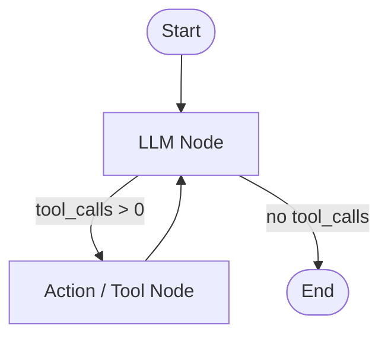

# Hello LangGraph

A modular and clean implementation of a cyclical ReAct-style AI Agent built with **[LangGraph](https://github.com/langchain-ai/langgraph)** and **[LangChain](https://github.com/langchain-ai/langchain)**. Supports both local LLMs (via Ollama) and cloud-based models (via OpenRouter / OpenAI API) with custom tool integration and graph visualization.

---

## 🚀 Features

- **Cyclical Graph Architecture**: Implements a standard ReAct loop (`LLM` &harr; `Action`) using LangGraph's `StateGraph`.
- **Hybrid LLM Support**: Switch seamlessly between local inference (Ollama) and cloud APIs (OpenRouter / OpenAI).
- **Custom Tool Integration**:
  - 🌦️ **Weather Tool**: Real-time live weather lookup using [wttr.in](https://wttr.in).
  - 🔍 **Web Search Tool**: Live web search with DuckDuckGo (`ddgs`) and optional Tavily API fallback.
- **State Management**: Built-in state tracking with `TypedDict` and message append reducer (`operator.add`).
- **Graph Visualization**: Auto-generates and exports the compiled agent workflow diagram to PNG.

---

## 📐 Architecture & Workflow

The agent uses a cyclical graph pattern:



1. **LLM Node (`llm`)**: Evaluates the input prompt and current message history. Decides whether to call a tool or respond to the user.
2. **Conditional Edge (`exists_action`)**: Checks if the model generated any `tool_calls`.
   - If tools are requested &rarr; routes to `action`.
   - If no tools requested &rarr; routes to `END`.
3. **Action Node (`action`)**: Invokes requested tools with provided arguments and returns `ToolMessage` results back to the LLM node.

---

## 📂 Project Structure

```text
hello-langgraph/
├── agent.py               # Main Agent graph definition, execution, and graph rendering
├── agent_state.py         # AgentState TypedDict definition and message reducer
├── config.py              # Model and environment configurations
├── llm.py                 # LLM factory (ChatOllama / ChatOpenAI)
├── tools.py               # Tool definitions (get_weather, web_search)
├── output_images/
│   └── graph.png          # Exported PNG diagram of the agent graph
├── pyproject.toml         # Project dependencies and packaging metadata
└── README.md              # Project documentation
```

---

## 🛠️ Prerequisites & Installation

### 1. Clone the repository
```bash
git clone https://github.com/NavaneeswarManam/hello-langgraph.git
cd hello-langgraph
```

### 2. Install dependencies

Using **[uv](https://github.com/astral-sh/uv)** (recommended):
```bash
uv sync
```

Or using standard `pip`:
```bash
python -m venv .venv
source .venv/bin/activate  # On Windows: .venv\Scripts\activate
pip install -e .
```

---

## ⚙️ Configuration

Create a `.env` file in the root directory (or configure via `config.py`):

```env
# Optional: Tavily Search API key
TAVILY_API_KEY=your_tavily_api_key_here

# OpenRouter / OpenAI Configuration
OPENAI_API_KEY=your_openrouter_or_openai_api_key
```

### Switching Between Local and Cloud Models

In `config.py`:
- Set `IS_LOCAL_MODEL = True` to use local models via [Ollama](https://ollama.com/) (e.g., `qwen3-coder:30b`, `llama3.2`, etc.).
- Set `IS_LOCAL_MODEL = False` to use cloud models via OpenRouter/OpenAI (e.g., `openai/gpt-5-mini`, `meta-llama/llama-3.3-70b-instruct`).

---

## 💻 Usage

Run the agent script directly:

```bash
python agent.py
```

Or with `uv`:

```bash
uv run python agent.py
```

### Example

```python
from agent import Agent, prompt, tools
from llm import llm
from config import TOOL_MODEL
from langchain_core.messages import HumanMessage

abot = Agent(llm(TOOL_MODEL), tools, system=prompt)
result = abot.graph.invoke(
    {"messages": [HumanMessage(content="What is the weather in Mumbai?")]}
)

print(result["messages"][-1].content)
```

The graph structure is automatically saved as a PNG image in `output_images/graph.png`.

---

## 🔧 Available Tools

| Tool | Function | Description | Source |
| :--- | :--- | :--- | :--- |
| **Weather** | `get_weather(city)` | Fetches current temperature, condition, and humidity | wttr.in |
| **Web Search** | `web_search(query)` | Searches the web for facts, news, and snippets | DuckDuckGo / Tavily |

---

## 📜 License

This project is open source and available under the [MIT License](LICENSE).
